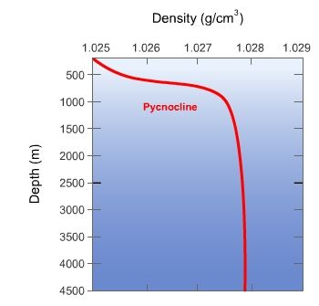

## Effect of Pressure on Density

* As pressure increases with increasing depth,

* so too does the density of seawater.

* With increased pressure, the molecules are pushed closer together, forcing more molecules into smaller volumes.

* So, there’s more mass contained within the same volume of water.

* An area of water where the density changes quickly with depth is pycnocline.