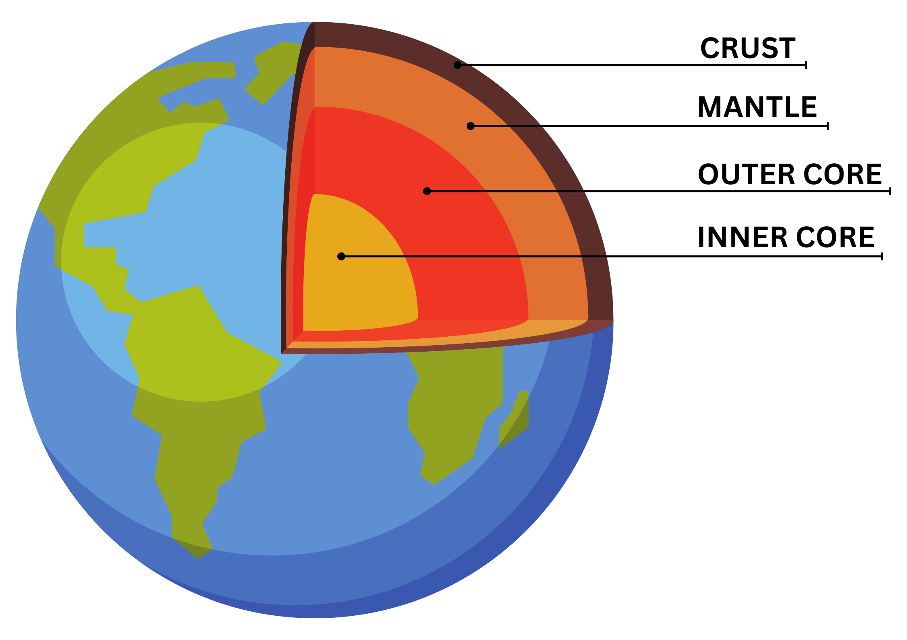

# EARTH PROCESSES

## Earth Structure Interior

* The tectonic plates are like carpets that continue to build themselves.

* Core is a hot sphere of dense elements,

  * iron and nickel where the inner part is solid while the outer part is liquid

  * the highest density is at the centre of the Earth.

* Mantle is a layer of hot semi solid rock capable of very slow movement over geological timescales, that surrounds the core

  * It is the thickest structure

  * The uppermost layer of the mantle is highly viscous and capable of deforming due to high temperatures

* Crust is the outermost layer of Earth

  * made up of solid rocks

  * the thinnest crust is oceanic crust and the thicker one is continental crust.