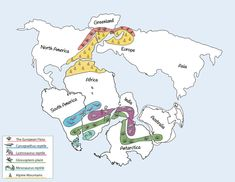

## Plate Tectonic Theory

* **Continental Drift** → A theory proposed by Alfred Wegener

  * explains that more than 300 millions of years ago, all the continents of the Earth were joined as a single landmass called Pangea

    

  * over the course of millions of years, Pangea began to split, and its pieces drift.

* To proof of this theory, Wegener came up with **plate tectonics** where the lithosphere is speculated to be broken into pieces called plates, which includes evidence such as:

  * Jigsaw fit of the continental coastlines

  * Geological matching of rocks formations on different continents

  * Distribution of similar fossils and living organisms on different continents

  * Formation of paleomagnetic stripes on the ocean floor from seafloor spreading.

* With the invention of SONAR in the 1940s, geological features showed a clear, predictable map of where the tectonic plates were separated.

  * This then leads to the creation of world ocean floor map which shows the prominent presence of the mid-ocean ridge

    

* Afterwards, they studied magnetism of the ocean floor using a magnetometer to find that the magnetic field of the ocean floor was laid out in alternating stripes of normal polarity and reversed polarity.

  * This phenomenon is then referred to as paleomagnetic stripes

  * This stripe has an origin from the ocean ridges, where the crust is weakest and magma often pushes through, this magma is the one that produces new stripes

  * This stripes are then found to be reversing on average every 250,000 years, changing magnetic north to magnetic south