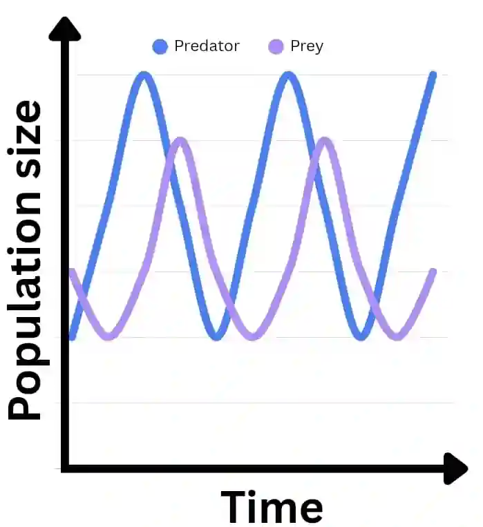

## Feeding Relationship

**Energy Origin & Autotrophs**

* Energy come from the sun

* which are synthesized by the autotrophs by..

  * photosynthesis which is a process that uses light to synthesize glucose from CO2 (can only take place in the photic zone thus 90% of marine life is found here)

  * chemosynthesis which is a process of synthesis of organic compounds by chemosynthetic bacteria, using energy from inorganic chemicals (ultimately still from the sun as those compounds were from the surface) which occurs at hydrothermal vents

**Heterotrophs**

* Then there would be heterotrophs which feed on autotrophs or other organisms to receive energy

* Heterotrophs are also more commonly known as consumer

* There are different types of consumers, such as;

  #|
  ||
  
  Term

  |
  
  Meaning

  |
  
  Marine Example

  ||
  ||
  
  Herbivore

  |
  
  Plant material eater (primary consumer)

  |
  
  Angel fish, Parrot fish

  ||
  ||
  
  Omnivore

  |
  
  Meat eater (predators)

  |
  
  Orca

  ||
  ||
  
  Carnivore

  |
  
  Plant and meat eater

  |
  
  Loggerhead

  ||
  |#
  

### Predation

* If prey ↓, predator would also ↓

* But if prey ↑, predator would also ↑ 

* It really depends on the supply, and why they fluctuate is because when predator ↑ more prey are eaten so prey will ↓ 

* Then when predator are ↓ from lack of food, more prey survive so it ↑ 