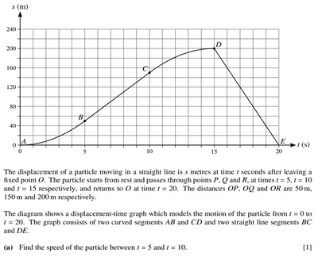
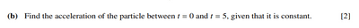
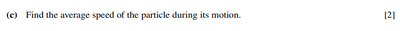

## Velocity-Time Graph

 

* Gradient = acceleration
* Area under graph = change in displacement

**{S22-P43} Question 3:**

 

solution (a):

speed is the gradient of a distance-time graph. The line between $t = 5$ and $t = 10$ is linear and so it has a constant speed. The gradient is $= \frac{Δy}{Δx} = \frac{150-50}{10-5} = \frac{100}{5} = 20$. So the speed of the particle between $t = 5$ and $t = 10$ is $20$ $ms^{-1}$

 solution (b):

Here lets look at what we are given first. We have time (5 seconds), we have initial velocity (as the particle starts from rest, initial velocity = 0), and final velocity (which is the answer to the previous question, as we are trying to find the gradient of the graph at point **B**)

$t = 5$ $s$, $u = 0$ $ms^{-1}$, $v = 20$ $ms^{-1}$

we can use the kinematic equation $v = u + at$ (as acceleration is constant). $a = \frac{v-u}{t} = \frac{20-0}{5} = 4$ $ms^{-2}$

So the acceleration of the particle between $t = 0$ and $t = 5$ is $= 4$ $ms^{-2}$

 solution (c)

the particle passes through the point **R** at $t = 15$, which is a distance of 200m from the starting point. after reaching point **R**, the particle travels a further 200m from $t = 15$ to $t = 20$. So the total distance traveled is 400m, which took 20 seconds to cover. avg speed = total distance/ total time = $\frac{400}{20} = 20$

So the average speed of the particle during its motion is $20$ $ms^{-1}$