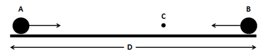

## Relative Velocities

‎‎

  - Let $s_A$ be the distance travelled by $A$ and $s_B$ for
    $B$

$$s_A = ut + \frac{1}{2}at^{2}\ \ \ \ \ \ \ \ s_B = ut + \frac{1}{2}at^{2}$$

  - If a collision occurs at point $C$

$$s_A + s_B = D$$

  - This gives you the time of when the collision occurred

  - Same analysis if motion is vertical