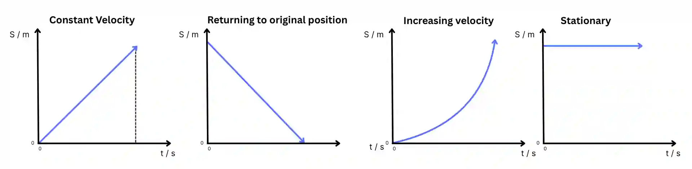

## Equations of Motion

Assume motion is in a straight line and acceleration is constant.

Displacement, velocity, and acceleration are vector quantities so their signs matter

* $v = u + at$

* $s = ut + \frac{1}{2}at^2$, $s = ut - \frac{1}{2}at^2$

  * Sign of $\frac{1}{2}at^2$ depends on the definition of positive direction, that is, defining upwards as positive and downwards as negative or vice versa

  * Decide if **upwards** is positive or **downwards** is positive

  * a = +g then use first equation

  * a  = -g then use second equation

* $v^2 = u^2+2as$

* $s = \frac{u+v}{2}t$

## Graphs

**Displacement-time graph**

* Gradient of a displacement time graph, that is, $\frac{S}{t}$ is velocity