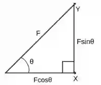
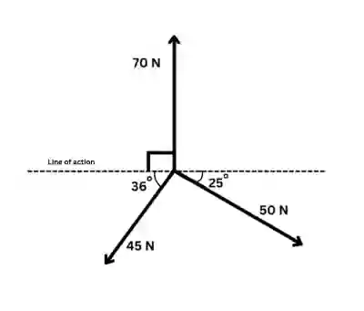
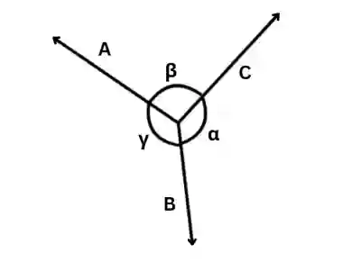

# Forces and Equilibrium

## Resolving Forces

* A force is a vector quantity, meaning it has both magnitude and direction.

* If a force acts at an angle $\theta$, it can be broken down into the horizontal and vertical components using trigonometry.

  * The horizontal and vertical components of the force are $F\cos\theta$ and $F\sin\theta$, respectively

    

* For all forces acting at a point, there exists a resultant force. To calculate the resultant:

  * Resolve the forces into their horizontal and vertical components and add all components algebraically

    $R_x = \sum F_x$

    $R_y = \sum F_y$

  * Use Pythagoras’ theorem to find the magnitude of the resultant

    $R =\sqrt{(R_x)^{2} + (R_y)^{2}}$

    *Note: Use calculated values instead of rounded for highest accuracy.*

  * Calculate the angle of the resultant force

    $\tan\theta = \frac{R_y}{R_x} \implies  \theta = \tan^{-1} (\frac{R_y}{R_x})$

    *Angle tells you the direction of the resultant*

  * Resultant force $= 0$ when the system is in equilibrium  i.e. $\sum Fx = 0, \sum Fy = 0$

---

### Worked Example

* **Resolving Forces:**

  $45\cos{36} $N, $ 50\cos{25} $N, 0 N-> Horizontal components of forces.

  $45\sin{36} $N, $ 50\sin{25} $N, 70 N -> Vertical components of the forces

* **Taking Directions (Up and right as positive, down and left as negative):**

  $ R_x = 50\cos{25} - 45\cos{36} $

  $ R_y = 70 - (45\sin{36} + 50\sin{25}) $ (Vertical components  are subtracted from the 70 N force because they act downwards.)

* **Magnitude of Resultant Force:**

  R $ = \sqrt{(50\cos{25} - 45\cos{36})^2 + (70 - (45\sin{36} + 50\sin{25}))^2}$

  R = 24.12 \~ 24.1N

  $\boxed{\bold{R} = 24.1 \text{N}}$

* **Calculating Angle of Resultant Force:**

  $\tan\theta = \frac{70 - (45\sin{36} + 50\sin{25})}{50\cos{25} - 45\cos{36}} $

  $\theta = \arctan{\frac{70 - (45\sin{36} + 50\sin{25})}{50\cos{25} - 45\cos{36}}} $

  $\theta = 68.3^{\circ} $ above the horizontal

  $\boxed{\bold{R} = 24.1 \text{N at } 68.3^{\circ} \text{above the horizontal}}$

---

### Lami’s Theorem

* For a body in equilibrium under three coplanar, concurrent, non-parallel forces

* $\frac{A}{\sin{\alpha}} = \frac{B}{\sin{\beta}} = \frac{C}{\sin{\gamma}}$

  