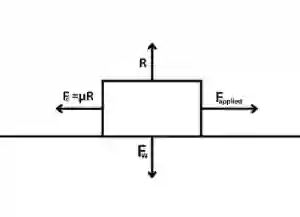
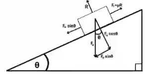
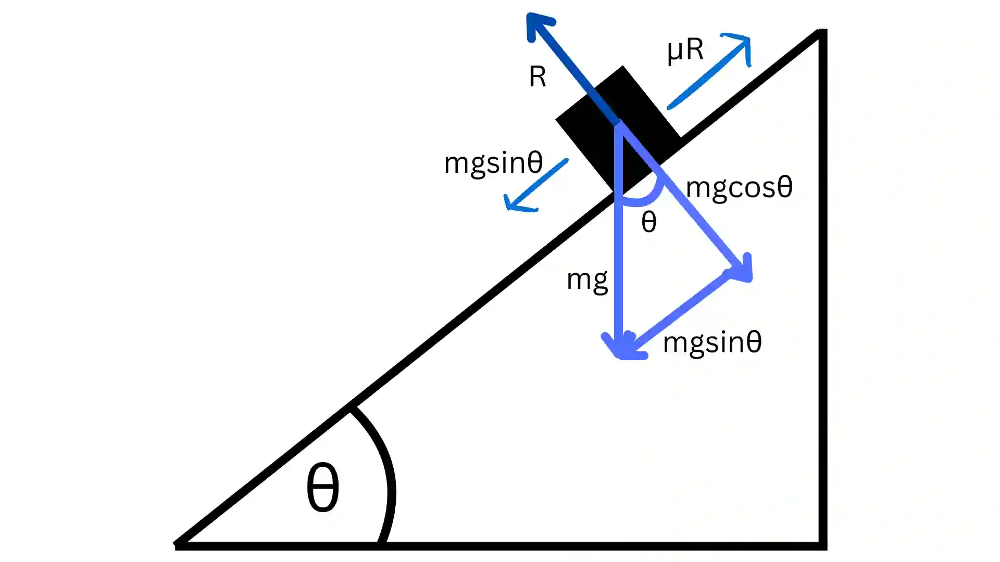

## Friction

* Friction is the force that opposes the relative motion between two surfaces in contact.

  $$F_{c} = \mu\times R$$

  Where:

  * $F_{c}$ = Frictional Force

  * $\mu$ = Coefficient of friction

  * $R$ = Normal Force (Force perpendicular to the contact surface)

    * In a horizontal plane: $R = mg$ (Mass $\times$ Gravitational Force)

    * In an inclined plane at an angle $\theta$: $R= mg\cos{\theta}$

* Friction always acts **opposite** to the direction of motion.

* Friction only occurs when surfaces are **rough.**

* A smooth surface implies **no friction.**

---

### **Frictional Force in a Horizontal Plane:**

---

### **Frictional Force in an Inclined Plane:**

---

### **Limiting Equilibrium**

* When a body is on the **point of moving**, friction is at its **maximum possible value**.
* If a force trying to cause motion is less than or equal to the maximum friction, the body will stay at rest. $F_c \le \mu R$
* If the applied force is **increased**, the body will start moving. $F_a > F_c$
* Body at the point of moving **up** the plane $\Rightarrow$ friction acts **down** the plane.
* Body at the point of moving **down** the plane $\Rightarrow$ friction acts **up** the plane.

### Worked Example:

A particle of mass 6 kg rests in limiting equilibrium on a plane inclined at $\theta$, where the coefficient of friction is $\mu=0.6$

### **(i) Find the angle $\theta$ at which limiting equilibrium occurs.**

First draw a diagram of the inclined plane

Downward component of weight = maximum friction

$mg\sin{\theta} = \mu \cdot mg\cos{\theta}$

$\tan{\theta} = \mu$

$\theta = \arctan{(\mu)}$

$\theta = \arctan{(0.6)} = 30.96\ \text{or}\ 31.0^{\circ}$

(**ii) Determine the acceleration of the particle down a plane inclined at 60$^{\circ}$**
From Newton’s first law, F = ma

$mg\sin{\theta} - \mu \cdot mg\cos{\theta} = ma$

$m(g\sin{60} - 0.6 \cdot g\cos{60}) = ma$

$5\sqrt{3} - 3 = a$

$a = 5.66$ ms$^{-2}$

**(iii) A force of magnitude F is applied parallel to the plane upwards (on the 60$^{\circ}$ plane). Find the least value of F required to move the particle up the plane.**

The force must overcome both the friction and the downwards component of the weight so:

F - $\mu \cdot$ mg$\cos{\theta}$ - mg$\sin{\theta}$ = 0

F$_{min}$ = $\mu \cdot$ mg$\cos{\theta}$ + mg$\sin{\theta}$

F$_{min}$ *=* $0.6 \cdot 6 \cdot 10 \cdot \cos{60} +  6 \cdot 10 \cdot \sin{60}$

F$_{min}$ = 18 + 30$\sqrt{3}$

F$_{min}$ = 69.96 \~ 70.0 N