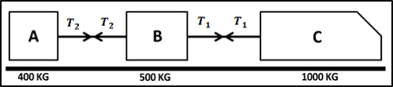

# Connected Particles

## Introduction

**Newton’s 3rd Law of Motion:**

*For every action, there is an equal and opposite reaction*

**Question:**

A train pulls two carriages:

 

The forward force of the engine is $F = 2500N$. Find the acceleration and tension in each coupling. The resistance to motion of A, B, and C are 90, 150, and 200N, respectively.

**
Solution:
**

To find acceleration, regard the system as a single object. The internal
$T$s cancel out and give:

$$
2500 - \left( 200 + 150 + 90 \right) = 1900a
$$

$$
\therefore a = 1.08ms^{- 2}
$$

To find $T_1,\ $look at C

$$
F - T_1 - 200 = 1000a
$$

$$
2500 - T_1 - 200 = 1000 \times 1.08
$$

$$
T_1 = 1220N
$$

To find $T_2,\ $look at A

$$
T_2 - 90 = 400a
$$

$$
T_2 - 90 = 400 \times 1.08
$$

$$
T_1 = 522N
$$

