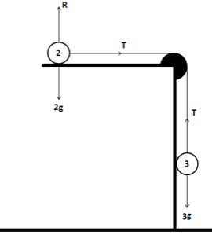
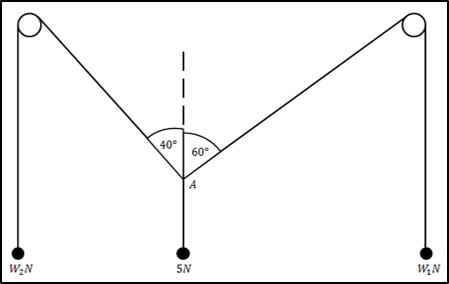
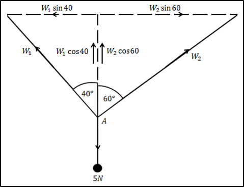
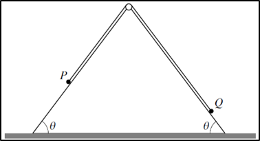

## Pulleys

  - Equation 1:

$$\therefore T = 2a$$

  - Equation 2:

$$3g - T = 3a$$

**{W05-P04} Question 3:**

The strings are in equilibrium. The pegs are smooth. All the weights are
vertical. Find $W_1$ and $W_2$

**
Solution
**

Diagram showing how to resolve forces:

Resolving forces at $A$ vertically:

$$W_1\cos 40 + W_2\cos 60 = 5$$

Resolving forces at A horizontally:

$$W_1\sin 40 = W_2\sin 60$$

Substitute second equation into first:

$$\left( \frac{W_2\sin 60}{\sin 40} \right)\cos 40 + W_2\cos 60 = 5$$

Solve to find $W_2$:

$$W_2 = 3.26N$$

Put this value back into the first equation to find $W_1$

$$W_1 = 4.40N$$

&nbsp;

**{S12-P41} Question 6:**

$P$ has a mass of $0.6kg$ and $Q$ has a mass of $0.4kg$. The
pulley and surface of both sides are smooth. The base of triangle is
horizontal. It is given that $\sin\theta = 0.8$. Initially particles
are held at rest on slopes with string taut. Particles are released and
move along the slope

1.  Find tension in string. Find acceleration of particles while both
    are moving.

2.  Speed of $P$ when it reaches the ground is $2ms^{- 1}$. When
    $P$ reaches the ground, it stops moving. $Q$ continues moving up
    slope but does not reach the pulley. Given this, find the time when
    $Q$ reaches its maximum height above ground since the instant it
    was released

**
Solution
**

**Part (i)**

Effect of weight caused by $P$ in direction of slope:

Effect of weight$\  = mg\sin\theta$ where $\sin\theta = 0.8$

Effect of weight$\  = 4.8N$

Effect of weight caused by $Q$ in direction of slope:

Effect of weight$\  = 0.4 \times 10 \times 0.8 = 3.2N$

Body $P$ has greater mass than body $Q$ so when released $P$ moves
down $Q$ moves up on their slopes $\therefore$

$$4.8 - T = 0.6a$$

$$T - 3.2 = 0.4a$$

Solve simultaneous equations:

$\frac{4.8 - T}{0.6} = \frac{T - 3.2}{0.4}$ $T = 3.84N$

Substitute back into initial equations to find $a$:

$4.8 - 3.84 = 0.6a$ $a = 1.6ms^{- 2}$

**Part (ii)**

Use kinematics equations to find the time which it takes $P$ to reach
the ground:

$a = \frac{v - u}{t}$ and $t = \frac{2 - 0}{1.6}$

$$t_1 = 1.25s$$

When $P$ reaches the ground, only force acting on $Q$ is its own
weight in the direction of slope $= 3.2N\ $

$F = ma$ $- 3.2 = 0.4a$

$$a = - 8ms^{- 2}$$

Now calculate the time taken for $Q$ to reach max height

This occurs when its final velocity is $0$.

$$- 8 = \frac{0 - 2}{t}\ \ \ \ \ t_2 = 0.25s$$

Now do simple addition to find total time:

Total Time$\  = 1.25 + 0.25 = 1.5s$