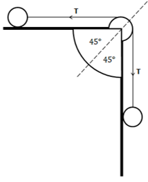
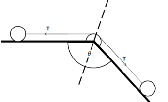

## Force Exerted by String on Pulley

<table>
<tbody>
<tr class="odd">
<td>
<strong>Pulley Case 1</strong>

<strong>Force on pulley =‎ <em>2T</em> ‎</strong>

<strong>Acts:</strong> downwards
</td>
<td>
<strong>Pulley Case 2</strong>

<strong>Force on pulley = <em>T√2</em> ‎</strong>

<strong>Acts:</strong> along dotted line
</td>
<td>
<strong>Pulley Case 3</strong>

<strong>Force on pulley = ‎<em>2T cos(1/2 θ)</em> ‎</strong>

<strong>Acts:</strong> inwards along dotted line which bisects θ
</td>
</tr>
</tbody>
</table>