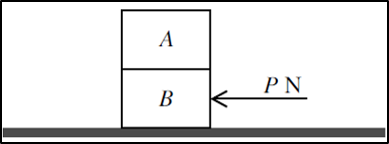

## Two Particles

**{S10-P43} Question 7:**

 

$A$ and $B$ are rectangular boxes of identical sizes and are at rest
on rough horizontal plane. $\text{A }$mass $= 200kg$ and $B$ mass
$= 250kg$. If $P \leq 3150$ boxes remain at rest. If $P > 3150$
boxes move

1. Find coefficient of friction between $B$ and floor
2. Coefficient of friction between boxes is $0.2$. Given that
   $P > 3150\ $and no sliding occurs between boxes. Show that the
   acceleration of boxes is not greater than $2ms^{- 2}$
3. Find the maximum possible value of $P$ in the above scenario

**
<u>Solution</u>
**

**Part (i)**

$$
F = \mu N
$$

$F =$ to max $P$ that does not move the boxes

$N =$ to contact force of **both** boxes acting on floor

$$
\therefore 3150 = \mu \times \left( 2000 + 2500 \right)
$$

$$
\mu = 0.7
$$

**Part (ii)**

Find frictional force between $A$ and $B$:

$F = 0.2 \times 2000$ $F = 400N$

Use Newton’s Second Law of Motion to find max acceleration for which
boxes do not slide (below $F)$

$400 = 200a$ $a = 2ms^{- 2}$

**Part (iii)**

$P$ has to cause an acceleration of $2ms^{- 2}$ on $B$ which will
pass on to $A$ as they are connected bodies

Simply implement Newton’s Second Law of Motion

$$
\therefore P = \left( 200 + 250 \right)\left( 2 \right) + 3150
$$

The $3150$ comes from the force required to overcome the friction

$P = 900 + 3150$ $ = 4050N$