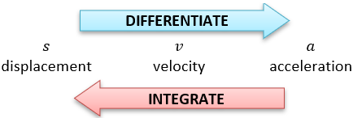
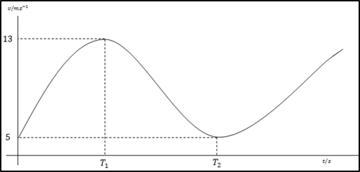
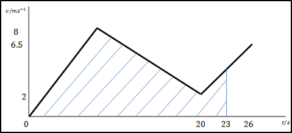

# General Motion in a Straight Line

 

* Particle at instantaneous rest, $v = 0$
* Maximum displacement from origin, $v = 0$
* Maximum velocity, $a = 0$

 

**{W10-P42} Question 7:**

Particle $P$ travels in straight line. It passes point $O$ with
velocity $5ms^{- 1}$ at time $t = 0s$.

$P$’s velocity after leaving $O$ given by:

$$
v = 0.002t^{3} - 0.12t^{2} + 1.8t + 5
$$

$\text{v }$of $P$ is increasing when: $0 < t < T_1$ and
$t > T_2$

$\text{v }$of $P$ is decreasing when: $T_1 < t < T_2$

i)  Find the values of $T_1$ and $T_2$ and distance
$\text{OP}$ when $t = T_2$

ii)  Find $v$ of $P$ when $t = T_2$ and sketch velocity-time
graph for the motion of $P$

**
Solution
**

**Part (i)**

Find stationary points of $v$; maximum is where $t = T_1$ and
minimum is where $t = T_2$

$$
\frac{\text{dv}}{\text{dt}} = 0.006t^{2} - 0.24t + 1.8
$$

Stationary points occur where $\frac{\text{dv}}{\text{dt}} = 0$

$$
\therefore 0.006t^{2} - 0.24t + 1.8 = 0
$$

Solve for $t$ in simple quadratic fashion:

$$
t = 30\ \ \ \ \ \ and\ \ \ \ \ \ 10
$$

Naturally $T_1$ comes before $T_2$

$$
\therefore T_1 = 10s\ \ \ \ \ \ \ \ \ \ and\ \ \ \ \ \ \ \ \ \ T_2 = 30
$$

Finding distance $\text{OP}$ by integrating

$$
\therefore s = \int_{0}^{30}v\text{dt}
$$

$$
s = \int_0^{30}\left( 0.002t^{3} - 0.12t^{2} + 1.8t + 5 \right)\text{dt}
$$

$$
s = \left\lbrack 0.0005t^{4} - 0.04t^{3} + 0.9t^{2} + 5t \right\rbrack_0^{30}
$$

$$
s = 285\ m
$$

**Part (ii)**

Do basic substitution to find $v$

$$
v = 0.002t^{3} - 0.12t^{2} + 1.8t + 5
$$

$$
t = 30\ \ \ \ \ \ \ \ \ \ \ v = 5
$$

To draw graph, find $\text{v }$of $P$ at $T_1$ using
substitution and plot roughly

$$
\text{v at }T_1 = 13
$$

Graph:

 

**{S13-P42} Question 6:**

Particle P moves in a straight line. Starts at rest at point $O$ and
moves towards a point $A$ on the line. During first $8$ seconds,
$P$’s speed increases to $8ms^{- 1}$ with constant acceleration.
During next $12$ seconds $P$’s speed decreases to $2ms^{- 1}$ with
constant deceleration. $P$ then moves with constant acceleration for
$6$ seconds reaching point $A$ with speed $6.5ms^{- 1}$

1. Sketch velocity-time graph for $P$’s motion
2. The displacement of $P$ from $O$, at time $t$ seconds after
   $P$ leaves $O$, is $\text{s\ }$metres. Shade region of the
   velocity-time graph representing $s$ for a value of $t$ where
   $20 \leq t \leq 26$
3. Show that for $20 \leq t \leq 26$,

$$
s = 0.375t^{2} - 13t + 202
$$

**
Solution:
**

**Part (i) and (ii)**

 

**Part (ii)**

First find $s$ when $t = 20$, this will produce a constant since
$20 \leq t \leq 26$

$$
s_1 = \frac{1}{2}\left( 8 \right)\left( 8 \right) + \frac{1}{2}\left( 8 + 2 \right)\left( 12 \right) = 92m
$$

Finding $s$ when $20 \leq t \leq 26$:

$$
s = ut + \frac{1}{2}at^{2}
$$

Since the distance before $20$ seconds has already been taken into
consideration:

$$
\mathbf{t = t - 20}
$$

$$
a = \frac{6.5 - 2}{6}
$$

$$
a = 0.75
$$

$$
\therefore s_2 = 2\left( t - 20 \right) + \frac{1}{2}\left( 0.75 \right)\left( t - 20 \right)^{2}
$$

$$
s_2 = 2t - 40 + 150 + 0.375t^{2} - 15t
$$

$$
s_2 = 0.375t^{2} - 13t + 110
$$

Finally, add both to give you $s$

$$
s = s_1 + s_2
$$

$$
s = 0.375t^{2} - 13t + 110 + 92
$$

$$
s = 0.375t^{2} - 13t + 202
$$

