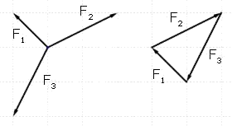
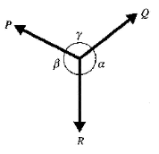

# Resolving Forces

## Resolving Forces

* If force $F$ makes an angle $\theta$ with a given direction, the
  effect of the force in that direction is $F\cos\theta\ $

$$
F\cos{\left( 90 - \theta \right) = F\sin\theta}
$$

$$
F\sin{\left( 90 - \theta \right) = F\cos\theta}
$$

* Forces in equilibrium: resultant = 0
* If drawn, forces will form a closed polygon

 

* **Methods of working out forces in equilibrium:**
  * Construct a triangle and work out the forces
  * Resolve forces in $x$ and $y$ directions; the sum of each = 0

 

**Lami’s Theorem:**

* For any set of three forces P, Q and R, in equilibrium  

$$
\frac{P}{\sin\alpha} = \frac{Q}{\sin\beta} = \frac{R}{\sin\gamma}
$$

