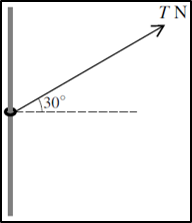

# Friction

## Introduction

$$
\mathrm{Friction\  = \ Coefficient\ of\ Friction\  \times \ Contact\ Force}
$$

$$
F = \mu r
$$

* Friction always acts in the opposite direction of motion
* Limiting equilibrium: on the point of moving, friction at max
  (limiting friction)
* Limiting equilibrium is also used to describe a situation when the object is about to slip, where friction is at its max
* Smooth contact: friction negligible
* **Contact Force:**
  * In situations where the particle is on a horizontal plane, the contact force or reaction force is equal to the weight of the particle ($mg$)
  * in situations where the particle is on an inclined plane, the contact force or reaction force is equal to the verticle component of the weight of the particle ($mgcos(θ)$)

### **Question:**

The ring has a mass of $2kg$. The horizontal rod is rough, and the coefficient of friction between the ring and rod is $0.24$. Find the two
values of $T$ for which the ring is in limiting equilibrium

### **Solution**

The ring is in limiting equilibrium in two different scenarios; we have
to find $T$ in both:

**Scenario 1: the ring is about to move upwards**

$$
Resultant = T\sin 30 - friction - Weight\ of\ Ring
$$

Since the system is in equilibrium, resultant = 0:

$$
Contact\ Force = T\cos 30
$$

$$
\therefore Friction = 0.24 \times T\cos 30
$$

Substitute relevant information into to initial equation

$$
0 = T\sin 30 - 0.24T\cos 30 - 20
$$

$$
T = 68.5N
$$

**Scenario 2: the ring is about to move downwards**

This time, friction acts in the opposite direction since friction opposes the direction of motion, thus:

$$
Resultant = T\sin 30 + Friction - Weight\ of\ Ring
$$

Using information from before:

$$
0 = T\sin 30 + 0.24T\cos 30 - 20
$$

$$
T = 28.3N
$$