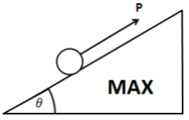
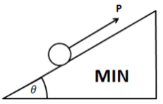
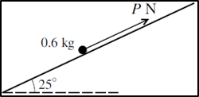

## Equilibrium

|***Force required to keep a particle in equilibrium on a rough plane***|
|:---|
||

|**Max Value**|**Min Value**|
|:---|:---|
|||
|The particle is about to move up. Thus, friction force acts down the slope $P = F + mg sinθ $|The particle is about slip down. Thus, frictional force acts up the slope$F + P = mg sinθ$|

### **Question:**

Coefficient of friction is $0.36$ and the particle is in equilibrium.
Find the possible values of $P$ 

### **Solution**

The magnitude of friction on particle in both scenarios is the same but
acting in opposite directions

Calculate the magnitude of friction first:

$$Contact\ Force = 6\cos 25$$

$$\therefore Friction = 0.36 \times 6\cos 25$$

**Scenario 1: particle is about to move upwards**

$$P = 6\sin 25 + Friction$$

$$P = 4.49N$$

**Scenario 2: particle is about to move downwards**

$$P = 6\sin 25 - friction$$

$$P = 0.578N$$