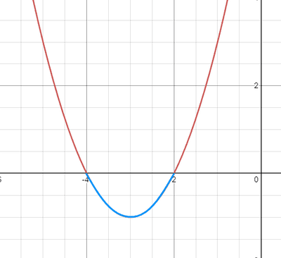

## Quadratic inequalities

An inequality question will ask us to find the values of $x$ for which the inequality holds true.

The most efficient way to solve these inequalities is to follow these steps.

* Factorise the inequality.
  * This will help us find the **intersections** of the quadratic with the $x$-axis
* Draw a **simple** sketch of the quadratic and label the $x$ coordinate of the intersections.
  * The quadratic curve will have a “**smiley**” or an **U shape** if the **coefficient** of $x^2$ is **positive.** This point is also known as a **minimum point**, or a **minima**.

   
  * The quadratic curve will have a “**frown**” or a **n shape** if the **coefficient** of $x^2$ is **negative.**

    This point is also known as a **maximum point**, or a **maxima**.

 

* Using your sketch, deduce the values of $x$ for which the inequality holds true.
* If a question asks you to find $y \leq 0$ or $y \geq 0$, then the points of intersections must be included in the range of values.

---

**
Example
**

Find the values of $x$ which satisfy the inequality $x^2 + 6x + 8 < 0$
**
Answer
**

* First notice that the coefficient of the quadratic is positive, $+x^2$, meaning the curve must be sketched in the shape of a smiley or an u.
* Then we can factorise $x^2 + 6x + 8$ to get $(x+4)(x+2)$. Upon factoring, it is clear that the roots are $x = -2$ and $x = -4$.

We can now sketch the parabola $y = (x + 4)(x + 2)$, labelling the intersections with the $x$-axis

 

The blue part of the curve represents the region where $y < 0$ and the red part of the curve represents the region where $y > 0$.

* As we’re trying to find the values of $x$ for which $y < 0$, we look at the blue region. Clearly any value that is greater than $-4$ and less than $-2$ is represented in the blue region. So the **answer** is $-4 < x < -2$.

