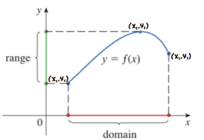

## Domain and Range

### Domain

* The **domain** of a function is the set of $x$-values, or **inputs**, that the function $f$ is defined for.
  * It consists of the **smallest** and **biggest** $x$-value the function accepts as an input, or is defined for.
  * Example: $x \in \mathbb{R}$ implies the function the function is defined for all real values of $x$.
  * $4 < x < 10$ implies the function is defined between $x$ = 4 and $x = 10$.

### Range

* The **range** of a function is the set of corresponding $y$-values, or **outputs**, that the function $f$ is defined for.
  * It consists of the **lowest** and the **highest** $y$-value the function outputs for a given domain.
  * Example: $y \in \mathbb{R}$ implies the function is defined for all real values of $y$.
  * $-2 \leq y \leq 5$ implies the function is defined between $y = -2$ and $y = 5$, where both values are inclusive.

---

**
Example
**

 

For this curve, $y = f(x)$:

* The range is $y_1 \leq f(x) \leq y_2$
  * Also written as $y_1 \leq y \leq y_2$
* The domain is $x_1 \leq x \leq x_3$

