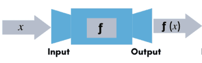
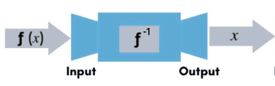

## Inverse Function

* An inverse function reverses another function.
  * Commonly denoted by $f^{-1}(x)$.
  * It is also important to note that $f^{-1}(x)$ does **not** imply $\frac{1}{f(x)}$.
* Inputting $x$ into the function $f$ outputs $f(x)$ while inputting $f(x)$ into $f^{-1}$ outputs $x$ \[also written as $f^{-1}(x)$\]

Consider a function $f$ and its inverse function $f^{-1}$. These two functions can be represented as

 
And

 This gives us an important result:

$$

f^{-1}(~f(x)~) = f(~f^{-1}(x)~) = x
$$

* An inverse function, $f^{-1}$, can **only** exist if the function $f$ has a **One to One** relation.
  * To check if an inverse function exists, we can use the **horizontal line test**.

### **Domain and Range of an Inverse Function**

Using the previous result, $f^{-1}(~f(x)~) = f(~f^{-1}(x)~) = x$, we can find the domain and range of an inverse function:

| Function | Domain | Range |
|----|----|----|
| $f(x)$ | $a < x < b$ | $c < y < d$ |
| $f^{-1}(x)$ | $c < x < d$ | $a < y < b$ |

We observe:

* The domain of $f(x)$ is the range of $f^{-1}(x)$, and vice versa
* The range of $f(x)$ is the domain of $f^{-1}(x)$, and vice versa.

### **Relationship between a Function and its Inverse**

Using the domain and range of a function and its inverse, we can graph both functions

 

Observations:

* Both functions are **symmetric** to the line $f(x) = x$
* Both functions **only** intersect at $f(x) = x$

### **Finding an Inverse Function**

* We can find the equation for an inverse function by “swapping” all the $x$ variables to $y$, and $y$ variables to $x$, and then making $y$ the subject of the formula again.

**
Example
**

Given $f(x) = 2x + 3$, find the inverse of this function.

**
Answer
**

We start by swapping the $x$ and $y$ values

$$

y = 2x + 3 \implies x = 2y + 3
$$

Now we can make $y$ the subject of the formula

$$

 y = \frac{x - 3}{2}
$$

So we get the inverse function as

$$

f^{-1}(x) = \frac{x - 3}{2}
$$

---

**
Example 1
**

Given

$$

f(x) = (x - 3)^2 - 2 ~~ \text{for} ~~ x > 4
$$

Find an expression for $f^{-1}(x)$ and find the domain of $f^{-1}$.

**
Answer
**

We start by swapping the $x$ and $y$ values.

$$

y = (x - 3)^2 - 2 \implies x = (y - 3)^2 - 2
$$

Now we can make $y$ the subject of the formula

$$

 y = \pm \sqrt{x + 2} + 3 
$$

* To correctly pick between + and - for the square root, we look at the domain of $f$. As the domain of $f$ is $x > 4$, the range of $f^{-1}$ must be $y > 4$. Due to this, we need to pick the positive value of the square root, as it is the only way we will get a $y$ value output greater than 4.

So we get the inverse function as

$$

f^{-1}(x) = +\sqrt{x + 2} + 3
$$

We can find the domain using the fact that the range of $f$ is the domain of $f^{-1}$.

At $x = 4$

$$

f(4) = (4 - 3)^2 - 2 = -1
$$

At $x = 5$

$$

f(5) = (5 - 3)^2 - 2 = 2
$$

The $y$ value ouput of the quadratic increases as the $x$ value input increases as well. So the range of $f$ is

$$

f(x) > -1
$$

This gives us the domain of $f^{-1}$ as

$$

x > -1
$$

**
Example 2
**

Given

$$

f(x) = -(x - 3)^2 + 4 ~~ \text{for} ~~ x \geq m
$$

Find the smallest value of $m$ such that the inverse function $f^{-1}$ exists.

**
Answer 
**

* An inverse function, $f^{-1}$, can **only** exist if the function $f$ has a **One to One** relation.

So we need to find the value of $m$ such that $f(x)$ is an One to One function.

We can deduce that the coordinates of the vertex are $(3, 4)$ from the given equation. Using this, we get the smallest value of $m$ as 3.

 So the domain for which the inverse function exists is 

$$

x \geq 3
$$

