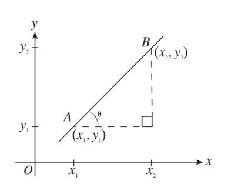

## The Gradient

* The gradient, also called the slope, describes the **inclination** of a line. It gives a numerical value to the **angle** a line makes with the **positive** $x$-axis.
  * It is popularly denoted by $m$ in the equation $y = mx + c$.

Consider two points, $A(x_1, y_1)$ and $B(x_2, y_2)$. A right angled triangle can be drawn, with a similar explanation to the one in the distance formula, with the hypotenuse line $AB$.

 

We can apply the trigonometric ratio

$$

tan(\theta) = \frac{\text{length of opposite side}}{\text{length of adjacent side}}
$$

In the context of the diagram above

$$

 tan(\theta) = \frac{y_2 - y_1}{x_2 - x_1}
$$

We will also denote $m$ as

$$

m = \frac{y_2 - y_1}{x_2 - x_1}
$$

Such that we are able to find the angle of inclination, $\theta$, by:

$$

tan(\theta) = m
$$

$$

\theta = tan^{-1}(m)
$$

### **Magnitude of the Gradient**

* The function is going to have an **increasing** $y$ value, as the $x$ value increases, if the gradient has a **positive** value. This means the curve is moving upwards.

* The function is going to have a **decreasing** $y$ value, as the $x$ value increases, if the gradient has a **negative** value. This means the curve is moving downwards.

### **Angle between two lines**

The angle, $\theta$, between two lines having gradients $m_1$ and $m_2$ is given by

$$
tan(\theta) = \pm \frac{m_2 - m_1}{1 + m_1m_2} 
\implies \theta = tan^{-1}\left(\pm \frac{m_2 - m_1}{1 + m_1m_2} \right)
$$

* Note that you must take the positive value of the ratio if you are trying to find the **acute angle** between two lines.

Another way to look at this formula is by considering the formula to find $\theta$ using the gradient $m$

 Let the line $AB$ have a gradient of $m_1$ and the line $DC$ have a gradient of $m_2$ such that

$$

tan(\theta_1) = m_1 \implies \theta_1 = tan^{-1}(m_1)
$$

$$

tan(\theta_2) = m_2 \implies \theta_2 = tan^{-1}(m_2)
$$

From the diagram above

$$

\theta_2 - \theta_1 = \theta
$$

This gives us

$$

tan^{-1}(m_2) ~ - ~ tan^{-1}(m_1) = \theta
$$

