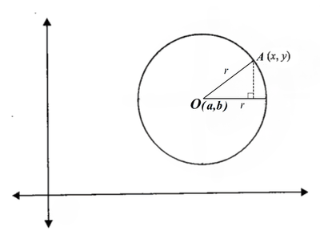

## Equation of a circle

* The equation of a circle helps us describe a circle on the coordinate plane.

 

* Consider a circle with centre $O(a, b)$ and radius $OA$, equal to $r$.
  * A perpendicular line from $A(x, y)$ can be drawn to depict a right angled triangle.
* This right angled triangle has:
  * $r$ as its hypotenuse
  * $(x - a)$ as its base
  * $(y - b)$ as its height

Using the Pythagoras theorem

$$

r^2 = (x - a)^2 + (y - b)^2
$$

* Where the coordinates of the centre, $O$, of this circle are $(a, b)$

The equation of a circle can be represented in different ways, and it is important to correctly identify the coordinates of the centre from them.

| Equation of circle | Coordinates of centre $O$ |
|----|----|
| $r^2 = (x - a)^2 + (y - b)^2$ | $(a, b)$ |
| $r^2 = (x + a)^2 + (y + b)^2$ | $(-a, -b)$ |
| $r^2 = (x + a)^2 + (y - b)^2$ | $(-a, b)$ |
| $r^2 = (x - a)^2 + (y + b)^2$ | $(a, -b)$ |

* A point, $(x , y)$, lies on the circumference of the circle if it satisfies the equation of the circle when inputted.
  * Which means inputting points $x$ and $y$ into the equation of the circle will give you the value of $r^2$ if it lies on the **circumference**.

### General equation of a circle

The expanded form of the equation of the circle is also known as the general equation of the circle.

$$

0 = x^2 - 2ax + y^2 - 2by + c
$$

Where $c = a^2 + b^2 - r^2$

| Centre | $(a, b)$ |
|----|----|
| **Radius** | $r = \sqrt{a^2 + b^2 - c}$ |

If the general form is given as

$$

0 = x^2 + 2ax + y^2 + 2by + c
$$

| Centre | $(-a, -b)$ |
|----|----|
| **Radius** | $r = \sqrt{a^2 + b^2 - c}$ |

* Another way to find the centre and radius is by **completing the square**, shown in the example 2 below.

---

**
Example 1
**

Points $A(-3,4)$ and $B(3, -4)$ lie on the circle, and the line $AB$ is the diameter of that circle. Find the equation of the circle.

**
Answer
**

Since the diameter is the line $AB$, its midpoint must be the coordinates of the centre $O$ of the circle.

$$
M = \left(\frac{x_1+x_2}{2}, \frac{y_1+y_2}{2}\right)
$$

$$
O = \left(\frac{-3+3}{2}, \frac{4-4}{2}\right)
$$

$$
O = (0,0) ~ [\text{This means the centre lies on the origin}]
$$

As the points $A$ and $B$ lie on the circle, they must also satisfy the equation of the circle when inputted. Using this fact, we can input one of their coordinates to find the radius. Here we use the coordinates of $A$.

$$
r^2 = (x - a)^2 + (y - b)^2
$$

$$
r^2 = (-3 - 0)^2 + (4 - 0)^2
$$

$$
r^2 = 25 \implies r = 5
$$

Thus, the equation of the circle can be written as

$$

x^2 + y^2 = 5^2
$$

**
 Example 2
**

Find the center and the radius of the circle with the equation $x^2 + y^2 -10x - 8y - 40 = 0$.

**
Answer
**

Given the equation of the circle, we can complete the square for $x$ and $y$ to get 

$$

(x-5)^2 - 25 + (y-4)^2 - 16 - 40 = 0

$$ 

$$
(x-5)^2 + (y-4)^2 = 81
$$

$$
(x-5)^2 + (y-4)^2 = 9^2
$$

The centre of the circle is $(5, 4)$ and the radius is $9$.