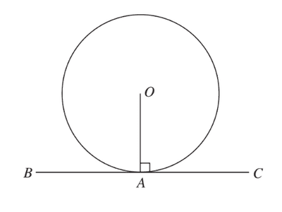

# Circular Measure

## Circle Theorems

These theorems **must** be known to solve circular measure questions.

|Circle|Theorem|
|:---|:---|
||Radius, $OA$, forms a $90^\circ$ degree, or $\frac{\pi}{2}$ radian angle, at the point of contact with a **tangent**.|
||The **perpendicular bisector** of a chord, $AB$, of a circle passes through the centre of the circle, $O$.|
||The **angle in a semi circle** is always equal to $90^\circ$ degrees, or $\frac{\pi}{2}$ radians.|
||Tangents which meet at the **same point** are **equal in** **length**, $TA = TB$, and angle $a = \text{angle} \sim b$.|
||The angle at the centre is **twice** the angle at the circumference.|
||Angles in the **same segment** are equal.|
