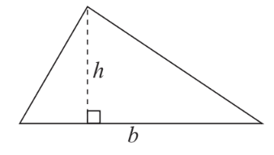

## Area of a triangle

Let us take a triangle, where $h$ represents the height and $b$ represents the base.

 

* The area of this triangle can be found using the formula $\frac{1}{2} \times base \times height$ or $\frac{1}{2} \times b \times h$.

### Alternative formula for the area of a triangle

Consider another triangle, where you aren’t given the base but have the values of 2 sides and 1 angle.

 

* To find the area of this triangle, we must first draw a perpendicular from $B$ to the line $AC$

 Utilising trigonometry, we observe that

$$

sin(C) = \frac{h}{a} \implies h = sin(C) \times a
$$

Taking the base as $b$ and height as $sin(C) \times a$, we can substitute it into the formula to find the area of this triangle as

$$

\frac{1}{2} \times a \times b \times sin(C)
$$

* Note that this formula requires you to use an angle $C$, such that it is not facing the side $a$ or side $b$ as shown in the diagram above.

