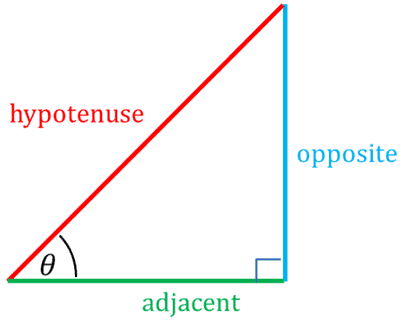
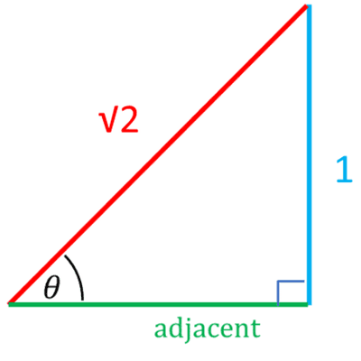

# Trigonometry

## Trigonometry ratios in right angle triangles (for θ between 0° and 90°)

 

$$

sin(\theta) = \frac{\text{opposite}}{\text{hypotenuse}}
$$

$$

cos(\theta) = \frac{\text{adjacent}}{\text{hypotenuse}}
$$

$$

tan(\theta) = \frac{\text{opposite}}{\text{adjacent}}
$$

* A mnemonic to remember the ratios is “SOH CAH TOA”.

---

### 
Example

Find the ratio of $cos(θ)$, when $sin(θ) = \frac{1}{\sqrt{2}}$

### 
Answer

### 
 Method 1

* Upon comparing $sin(\theta) = \frac{1}{\sqrt{2}}$ and  $sin(\theta) = \frac{\text{opposite}}{\text{hypotenuse}}$, we note that the length of the opposite side is 1 and the length of the hypotenuse is $\sqrt{2}$.

We can now use the Pythagoras theorem to find the adjacent side of the triangle:

 

$$

(\text{adjacent})^2 +(1)^2 = (\sqrt{2})^2 = 1
$$

$$

cos(\theta) = \frac{\text{adjacent}}{\text{hypotenuse}} = \frac{1}{\sqrt{2}}
$$

### 
Method 2

Using the fact that

$$

sin(\theta) = \frac{1}{\sqrt{2}} \implies \theta = sin^{-1}\left(\frac{1}{\sqrt{2}}\right) = 45^\circ 
$$

$$

cos(45^\circ) = \frac{1}{\sqrt{2}} \implies cos(\theta) = \frac{1}{\sqrt{2}}
$$

