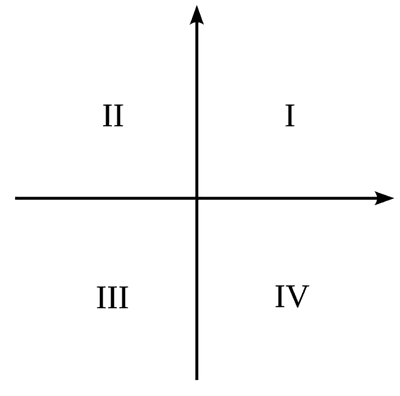
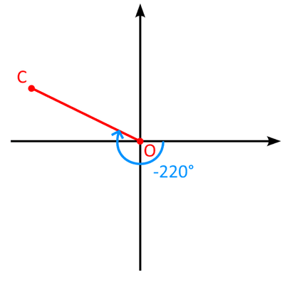
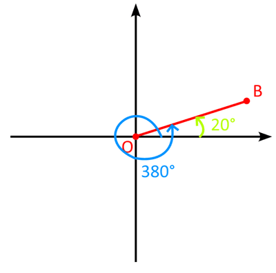

## Quadrants

* The Cartesian plane is divided into 4 quadrants \n  
* an anticlockwise rotation from the x-axis of the first quadrant shows an increase in angle, but clockwise rotation shows a decrease in angle

### 
Example

draw a line on a graph OA which is rotated 140°, a line OB rotated 380°, and a line OC rotated -220° Answer:

       