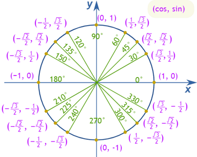

## Quadrant - continued

 

* First quadrant
  * $cos(θ) = +ve$
  * $sin(θ) = +ve$
  * $tan(θ) = +ve$
* Second quadrant
  * $cos(θ) = -ve$
  * $sin(θ) = +ve$
  * $tan(θ) = -ve$
* Third quadrant
  * $cos(θ) = -ve$
  * $sin(θ) = -ve$
  * $tan(θ) = +ve$
* Fourth quadrant
  * $cos(θ) = +ve$
  * $sin(θ) = -ve$
  * $tan(θ) = -ve$

