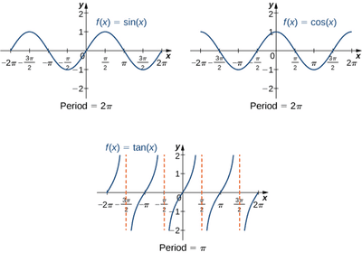
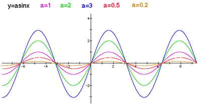
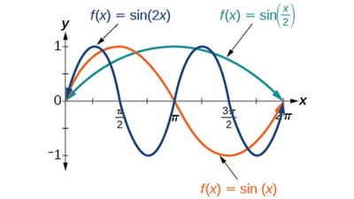
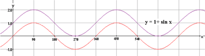
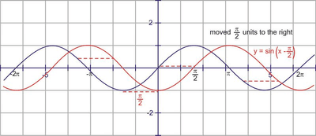
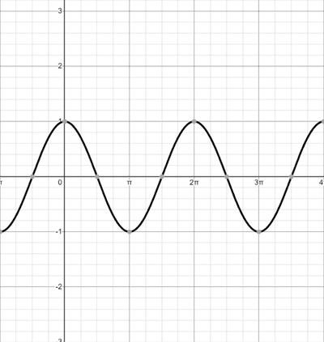
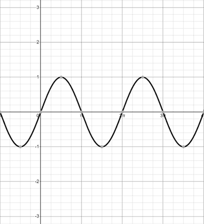
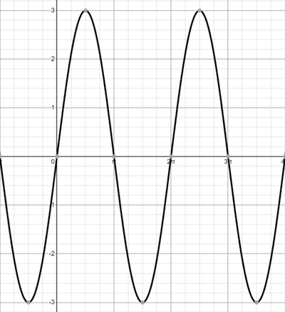
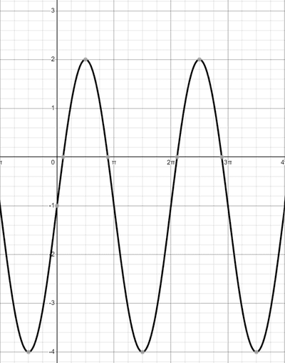

## Graphs of Trigonometric functions

 

* period is the length of one cycle of the graph
* amplitude is the distance between the maximum or minimum points from the principal axis
* graph of $y = asin(x)$
  * The graph is stretched along the y-axis with a factor of $a$
  * The range of the graph changes to $a < y < -a$   
* graph of $y=sin(ax)$
  * the period of the graph is $\frac{2π}{a}$
  * the graph is stretched along the x-axis by a factor of $\frac{1}{a}$

 

* graph of $y = sin(x) + a$
  * the graph is shifted along the y-axis by the value of $a$
  * translation of the graph by \[0, $a$\]
  * The range of the graph changes to $-1 + a < y < 1 + a$

   
* graph of $y = sin(x + a)$
  * the graph is shifted along the x-axis by the value of -$a$
  * translation of the graph by \[-$a$, 0\]

   
* When working with multiple transformations, go with this order:
  * firstly, work with the transformation inside the brackets of the trigonometric function
  * secondly, apply the transformation multiplied/divided to the trigonometric function
  * lastly, apply the transformation which is being added/subtracted to the trigonometric function.

---

### 
Example

Draw the graph of $y = 3cos(x - \frac{1}{2}π) - 1$

### 
Answer

* draw the graph of $y = cos(x)$

 

* apply the transformation inside the brackets $(x-90)$, which translates the graph by

  $(90,0)$

  
   

  
* apply the transformation which is being multiplied/divided to the trig function, in this case 3, which should stretch the graph by a factor of 3 along the y-axis

 

* finally, apply the transformation that is being added/subtracted to the expression, in this case it is $-1$, which would translate the graph by $(0,-1)$

 