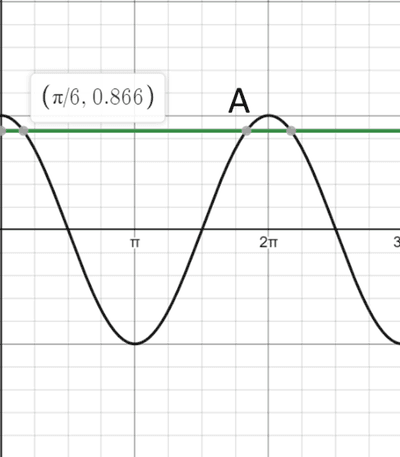

## Find the other angles from the principle angle

* in case of $cos(x) = \frac{\sqrt{3}}{2}$, we know using a calculator or by memory that $x = 30°$ or $x = \frac{π}{6}$, but this is only the principle angle and there are many more solutions to this.
* to find the other values, draw a graph and draw a horizontal line for the value given to find the angles at which the trigonometric function give the value stated. in the previous example, the graph would look like this

   
* as you can see there are also other points on the graph which intersect with the horizontal line, these are also additional solutions
* in the question, a range might be given and you would have to find all the solutions in that given range.
* in this case, to find the other point $A$ we can do $2π - \frac{π}{6}$, which equals to $\frac{11π}{6}$
* here we are using the property of trigonometry functions that they are symmetrical, and thus such calculations can be used to find the angles

