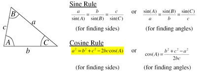
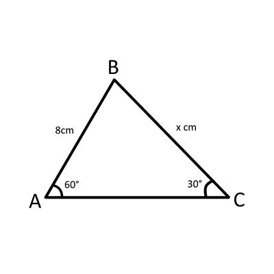
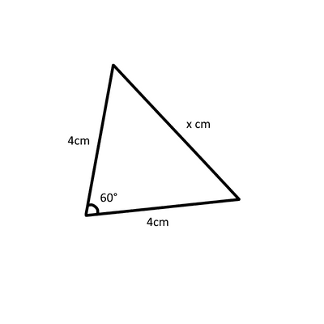

## Trigonometry with non right-angled triangles

* in these cases, you can either use the sine rule or the cosine rule

  

**
Example
**

Find the value of $x$

**
Answer
**

in this question, we are given two angles and one of the sides, where we have to find the length of the other side.

So we know we should use the sine rule $\frac{a}{sin(A)} = \frac{b}{sin(B)} = \frac{c}{sin(C)}$

we can write this as $\frac{8}{sin(30)} = \frac{x}{sin(60)}$

cross multiplying it would give us

$8sin(60) = xsin(30)$

$8*\frac{\sqrt{3}}{2} = \frac{1}{2}x$

$8\sqrt{3} = x$

∴ $x = 8\sqrt{3}$

### Example

Find the value of $x$

Answer:

in this question, we are given two side lengths and the angle between them

in this case, we shall use the cosine rule $a^2 = b^2 + c^2-(2bc*cos(A))$

we can write this as $x^2 = 4^2 + 4^2-(2*4*4*cos(60))$

$x^2 = 16+16-(16)$

$x^2 = 16$

∴ $x = 4$