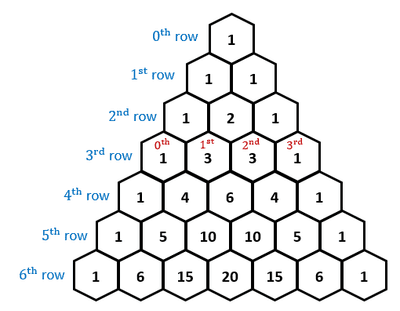

# Series

## Introduction to nCr notation

* Combinatorics helps us find the $r^{th}$ element in the $n^{th}$ row of pascal’s triangle, which is a triangle that is constructed by summing the adjacent elements in the previous row.

Pascal’s triangle

 

* As an example, from the definition, ${}^3C_1$ will give us a value of 3.
* The triangle is also symmetrical at the centre

### **Factorial notation**

The factorial notation is used in the formula for combinations.

$$

n! = n \times (n - 1) \times (n - 2) \times \cdots \times 2 \times 1
$$

For example

$$

5! = 5 \times 4 \times 3 \times 2 \times 1 = 120
$$

It should also be known that

$$

0! = 1
$$

### **Combinations**

The notation you should be familiar for combinations is

$$

{}^nC_r = {n \choose r} = \frac{n!}{r!(n - r)!}
$$

Using this, we obtain some useful results

$$

{}^nC_0 = {}^nC_n = 1
$$

$$

{}^nC_1 = {}^nC_{n ~ - ~ 1} = n
$$

$$

{}^nC_r = {}^nC_{n ~ - ~ r}
$$

* Reinstating, ${n \choose r}$ gives us the $r^{th}$ element in the $n^{th}$ row of pascal’s triangle.
* Most calculators have a pre-defined function, or button, that allows you to use the ${}^nC_r$ formula directly.

