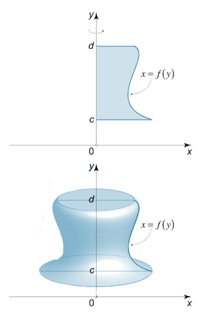

## Volume of Revolution

- The volume of revolution of a solid rotated around an axis by $360^\circ$ degrees gives us a 3D shape.
- It is also possible to find the volume between two solid areas by subtracting the upper volume from the lower volume.

- To find the volume of revolution around the $x$-axis by 360 degrees
$$
V = \pi \int_{x ~=~ a}^{x ~=~ b} y^2 ~dx 
$$

$$
\phantom{invis}
$$

- To find the volume of revolution around the $y$-axis by 360 degrees
$$
V = \pi \int_{y ~=~ c}^{y ~=~ d} x^2 ~dy
$$

- Note that you do not need to square the equation if it is already in terms of $y^2$ or $x^2$

---

**
Example 1
**
Find the volume of the solid of revolution formed when the area under the graph of $y = x^3$ between x-coordinates $3$ and $6$ rotates 360° around the x-axis

**
Answer
**
First we need to get the equation in terms of $y^2$
$$
y = x^3 \implies y^2 = x^6
$$
Now we can evaluate the integral using the limits given
$$
V = \pi \int_{3}^{6} x^6 ~dx
$$

$$
\pi \left( \frac{x^{6 + 1}}{6 + 1} \right)_{3}^{6}
$$

$$
V = \pi \left(\frac{6^7}{7} - \frac{3^7}{7} \right)
$$

$$
V = \frac{277749 \pi}{7}
$$

So the volume of revolution the around $x$-axis by 360 degrees is $\frac{277749 \pi}{7}$

$$
\phantom{invis}
$$

**
Example 2
**
Find the volume of revolution when the area under the graph of $y^4 = x^2$ between $y$-coordinates $2$ and $4$ rotated 360° around the $y$-axis.

**
Answer
**

As the equation is already in terms of $x^2$, we can directly evaluate the integral.

$$
V = \pi \int_{2}^{4} y^4 ~dy
$$

$$
 \pi \left(\frac{y^{4 + 1}}{4 + 1} \right)_{2}^{4}
$$

$$
 \pi \left(\frac{4^5}{5}-\frac{2^5}{5} \right)
$$

$$
V = \frac{992 \pi}{5}
$$

So the volume is equal to $\frac{992 \pi}{5}$

