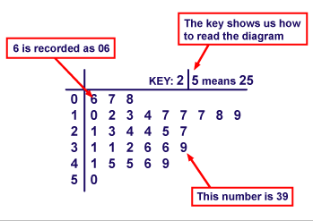

## Stem-and-Leaf Diagrams

* Used to represent data in its original form
* Each piece of data split into 2 parts; stem & leaf
* Leaf can only by 1 digit and should be written in ascending order
* Always include a key on your diagram

 

* **Advantage:** contains accuracy of original data

Back-to-back stem-and-leaf diagrams

* Note the order of the left side

 