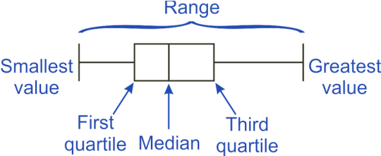

## Box-and-Whisker Plots

  - Five figure summary:
    
      - Lowest and highest values
    
      - Lower and upper quartiles
    
      - Median

  - Mean & standard deviation most useful when data roughly symmetrical
    & contains no outliers

  - Median and interquartile range typically used if data skewed or if
    there are outliers.

  - **Advantage:** easily interpreted and comparisons can easily be
    made.