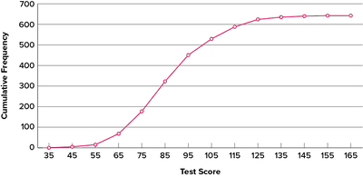

## Cumulative Frequency Graphs

* Upper quartile $= 75%$th percentile value
* Lower quartile $= 25%$th percentile value
* Median $=50%$th percentile value

$$
Interquartile\ Range = Upper\ Quartile - Lower\ Quartile 
$$

* When finding the median and quartiles, draw in vertical and horizontal dashed lines on the graph, and find the corresponding x-axis value(s)
* Points are plotted at upper class boundaries
* Join points together with straight lines unless asked to draw a
  cumulative frequency curve

## Key Points:

1. Add up preceding frequencies in the table to get the cumulative frequency
2. Plot points at the upper limit of the class interval
3. Ensure the curve through the points is smooth

    

