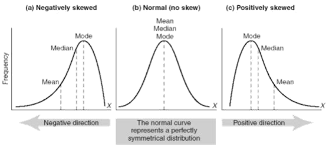

## Skewness

* **Symmetrical:** Median line lies in the middle of the box (i.e. UQ
  – median = median – LQ)
* **Positively skewed:** Median line lies closer to LQ than UQ (i.e. UQ – median > median – LQ)
* **Negatively skewed:** Median line lies closer to UQ than LQ (i.e. UQ – median < median – LQ)

 