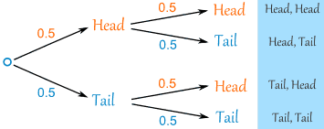

# Probability

## Basic Rules

* All probabilities lie between $0$ and $1$
* $P\left( A \right) =$ The probability of event $\text{A}$

  $$
  \text{P(A)} = \frac{\text{Number of equally likely outcomes}}{\text{Total number of equally likely outcomes}}
  $$
* $P\left( A^{'} \right) = \ \ 1 - P\left( A \right) =$ The probability of not$\text{ A}$
* To simplify a question, represent info in a tree diagram:

 

**{S08-P06} Question 7:**

A die is biased so that the probability of throwing a 5 is 0.75 and the probabilities of throwing a 1, 2, 3, 4 or 6 are all equal. The die is thrown thrice. Find the probability that the result is 1 followed by 5 followed by any even number.

**
Solution:
**

*The probability of getting a 1*

$$
1 - 0.75 = 0.25
$$

5 numbers $\therefore$ $0.25 \div 5 = 0.05$

*The probability of getting a 5* $= 0.75$

*The probability of getting an even number can be 2, 4 or 6* $\therefore$

$$
0.05 \times 3 = 0.15
$$

*Total Probability*

$$
0.05 \times 0.75 \times 0.15 = 0.00563
$$

