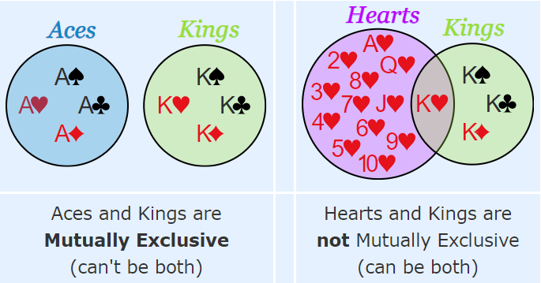

## Mutually Exclusive Events

 

* 2 events which have no common outcomes or can’t happen at the same
  time.
* Examples of MEEs:
  * Looking Left & Looking Right.
  * Coin toss: Heads & Tails.
  * Cards: Kings & Aces.
* Examples of *not* MEEs:
  * Cards: Kings and Hearts. (we have Kings of Hearts)
  * Students: People who study French and Spanish (some can study
    both)
* **Rules of MEEs:**

$$
P\left( \text{A and B} \right) = 0
$$

In other words, the probability of both events happening is 0 because they can’t occur at the same time.

$$
P(A\ or\ B) = P(A) + P(B)
$$

In other words, the probability of A or B happening is just their individual probabilities being added together. *Example:*

*P(Get King AND Queen) = 0*

*P(Get King OR Queen) = 1/13 + 1/13*

* **Rules of *Not* MEEs:**

$$
P\left( \text{A and B} \right) \neq 0
$$

Because events can happen at the same time, the probability of both events happening is not 0.

$$
P\left( \text{A or B} \right) = P\left( A \right) + P\left( B \right) - P\left( \text{A and B} \right)
$$

When adding P(A) & P(B), we counted the “middle part” twice, so we must
subtract it.

*Example:*

*P(Get Kings or Hearts) = 4/52 + 13/52 – 1/52*

*1/52 comes from the king of hearts*