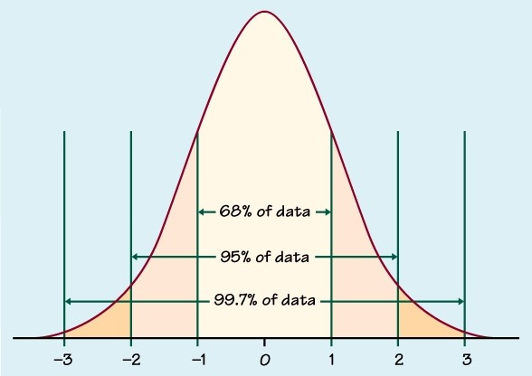

# The Normal Distribution

## Introduction
* A normal distribution is used to model a **continuous** random variable, thus it is a **continuous distribution** and not a discrete distribution. It has two parameters, the mean ($\mu$) and the variance ($\sigma^2$).

A continuous random variable that follows a normal distribution, $N(\mu, \sigma^2)$ can be written as follow
$$
X \sim N(\mu, \sigma^2)
$$

* The area under the graph represents probability
* The mean ($\mu$) acts as a line of symmetry
   * 50% of the probability lies on the right side and 50% of the probability lies on the left side.
- The standard deviation represents how spread out a value is from the mean.

