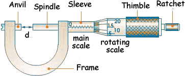
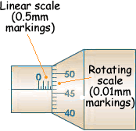

# Micrometre Screw Gauge

‎ 
‎ 

Measures objects up to $0.01mm$

* Place object between **anvil** & **spindle**
* Rotate **thimble** until object firmly held by jaws
* Add together value from the main scale and rotating scale

