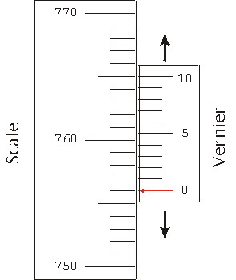

# Vernier Scale

‎ 

Measures objects up to $0.1mm$

* Place object on the rule
* Push the slide scale to the edge of object.
* The sliding scale is $0.9mm$ long & is divided into $10$ equal
  divisions.
* Check which line division on sliding scale matches with a line
  division on the rule
* Subtract the value from the sliding scale
  ($0.09 \times Divisions)$ by the value from the rule.

