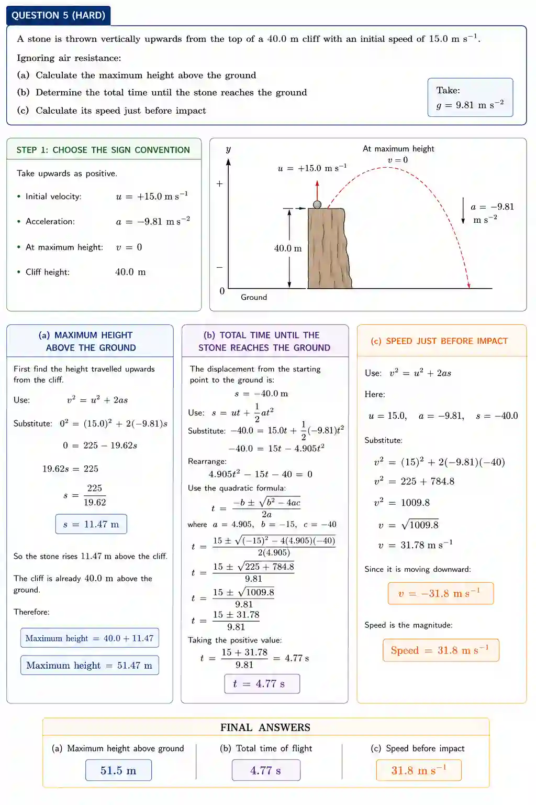

## Equation of motion

### Deriving equations of motion

Symbols

* $u$ - initial velocity

* $v$ - final velocity

* $s$ - displacement

* $t$ - time

* $a$ - accleration

  #|
  ||
  
  Equation

  |
  
  $v=u+at$

  |
  
  $s = \frac{(v+u)t}{2}$

  |
  
  ${s=ut+\frac{1}{2}at^2}$

  |
  
  ${v^2=u^2+2as}$

  ||
  ||
  
  Derivation

  |
  
  Acceleration is the rate of change of velocity having the equation : $a = \frac{v-u}{t}$

  Rearranging it we get

  $at = v-u$

  $v=u+at$

  |
  
  Average velocity = $\frac{u+v}{2}$

  $\frac{s}{t}=\frac{u+v}{2}$

  ${s=\frac{(u+v)t}{2}}$

  |
  
  $s=\frac{(u+v)t}{2}$

  $v=u+at$

  $s=\frac{(u+u+at)t}{2}$

  $s=\frac{(2u+at)t}{2}$

  ${s=ut+\frac{1}{2}at^2}$

  |
  
  $v=u+at$

  $t=\frac{v-u}{a}$

  $s=\frac{(u+v)t}{2}$

  $s=\frac{(u+v)}{2}\left\(\frac{v-u}{a}\right\)$

  $s=\frac{(u+v)(v-u)}{2a}$

  $2as=(u+v)(v-u)$

  $2as=v^2-u^2$

  $v^2=u^2+2as$

  ||
  |#
  

Example sum:

A car starts from rest and accelerates uniformly at $4.0\mathrm{ms^{-2}}$ for $10\mathrm{s}$

Find:

* a) Find velocity

* b) Find Distance travelled

Ans : a)  $v=u+at=0+(4.0)(10)=\boxed{40\mathrm{ms^{-1}}}$

Ans : b) $s = ut + \frac{1}{2}at^2$

$$ s = 0 + \frac{1}{2}(4.0)(10)^2 = 200,\mathrm{m} $$ $=$ $$ \boxed{s = 200,\mathrm{m}} $$

### Motion of bodies without the presence of air resistence

