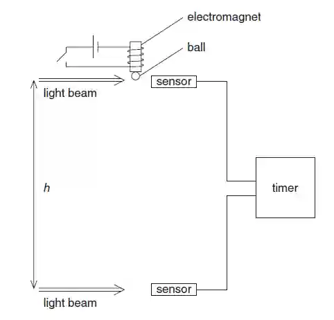

## Experiment to determine acceleration of free fall

**Apparatus Required**: Electromagnet, Meter rule, Sensor, Metal ball, Ball bearing, digital stopwatch

### **Method**

* When current is turned on, the ball is attached to the magnet and set up apparatus as shown above in the image.

* Use meter rule to measure $h$. Take a reading for $h$ minimum of 3 times.

* Turn of the current so that the ball falls

* When the ball passes the 1st sensor’s light beam the time starts and when it passes the 2nd sensors light beam the timer stops

* Repeat this 3 times to reduce anomalies and random error

* Plot a graph of Vertical distance *h* **is plotted against** $t^2$

**Formula**

$s = ut + \frac{1}{2}at^2$ and $u = 0$ ; $s = \frac{1}{2}at^2$ i.e $h = \frac{1}{2}gt^2$