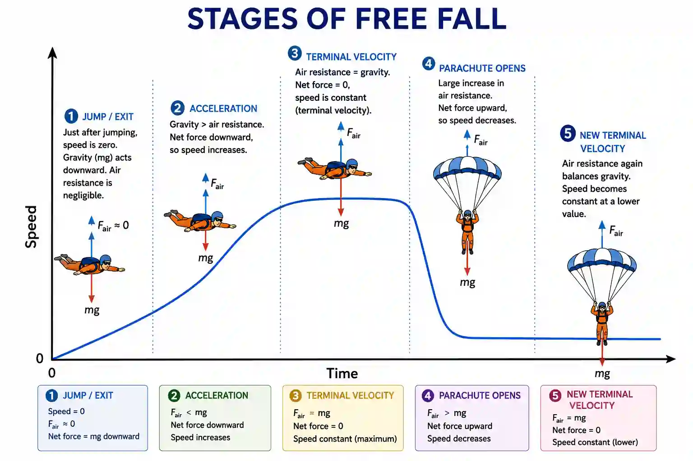

## Terminal Velocity and Acceleration of free fall

### Terminal Velocity

* As mentioned before, **terminal velocity is when the forces acting on an object are equal, so the resultant force is 0 and velocity is constant.**

### Body in Free Fall

* ### At first, when a body falls, the only force acting on it is its weight, so acceleration is *g*.

* As the body falls further, air resistance increases. It acts in the opposite direction to weight, decreasing the resultant force and causing the acceleration to decrease.

* Eventually, weight and air resistance become equal, resulting in terminal velocity (the maximum *v*).

* This process continues and repeats when a change is made to the body, until a new terminal velocity is reached and it falls and stops

### Projectile motion with air resistance 

* **Air resistance (drag)** acts in the **opposite direction to the motion**.

* The drag force **increases as the speed of the projectile increases**.

* Therefore, air resistance affects both the **horizontal and vertical motion**.

**During the upward motion:**

* The projectile moves upwards and forwards.

* Weight acts **downwards**.

* Air resistance acts **backwards and downwards**, opposing the motion.

* The projectile slows down more quickly than it would without air resistance 

  **At the highest point**

* The **vertical velocity is zero** for an instant.

* The projectile may still have horizontal velocity.

* Air resistance therefore acts mainly **horizontally backwards**.

**During the downward motion**

* The projectile moves downwards and forwards.

* Weight acts **downwards**.

* Air resistance acts **upwards and backwards**, opposing the motion.

* As speed increases, the drag force increases.