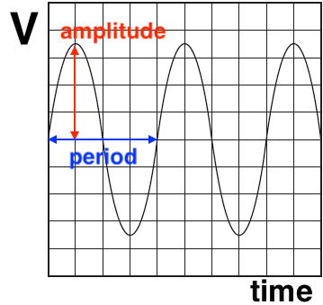

# Waves

## Progressive waves

### Definitions

* **Wave motion:** A propagation of disturbance that travels from one location to another.

* **Displacement:** Distance of a point from its undisturbed (equilibrium) position

* **Amplitude:** Maximum displacement of a particle from an undisturbed position

* **Period:** Time taken for one complete oscillation

* **Frequency:** Number of oscillations per unit time

* **Wavelength:** Distance from any point on the wave to the next precisely similar point (e.g. crest to crest)

* **Wave speed:** Speed at which the waveform travels in the direction of the propagation of the wave

* **Progressive** waves transfer energy from one position to another.

### Deriving speed using wavelength & frequency

From the definition we can arrive at the formula $F$=$\frac{1}{T}$

Distance of 1 wavelength is λ

Speed = $\frac{Distance}{Time}$

Speed = $\frac{λ}{T}$ $\rightarrow$ Speed = $\lambda F , v=\lambda F$

### Phase difference

* Phase difference between two waves is the difference in terms of fraction of a cycle or in terms of angles (**A B)**

Phase difference = $\frac{x}{\lambda} \times 2 \pi$ (unit: radians or degrees)

* Let the phase difference between wave 1 & 2 at $x_1$ & $x_2$ be $\theta$ then it can be said that wave 2 is ahead of wave 1 by $\theta$

* In phase - 0 , 2$\pi$ (Formula - $2n\pi$) (respective angles in degrees)

* Antiphase - $\pi$ , 3$\pi$ (Formula - (2n\+1)$\pi$) (respective angles in degrees)

### Worked example

A sound wave has a frequency of 500 Hz and travels through air at a speed of 340 $ms^{-1}$

Two points A and B on the wave are separated by a distance of 0.238 m.

Calculate the phase difference between points A and B, giving your answer in radians.

Ans : $\lambda=\frac{v}{f}$

$\lambda=\frac{340}{500}=0.680\text{m}$

$\Delta\phi=\frac{2\pi x}{\lambda}$

$\Delta\phi=\frac{2\pi(0.238)}{0.680}$

$\boxed{\Delta\phi=2.20\text{rad}}$

### Intensity

Rate of energy transmitted per unit area perpendicular to direction of wave propagation

* Units - $Wm^{-2}$ (Watts per squared metre)

* Intensity =  $\frac{\text{Power}}{\text{Cross Sectional Area}}$

* intensity ∝ $(amplitude)^2$

* For a point source: Intensity =  $\frac{\text{Power}}{\text{Cross Sectional Area}}$ =  $\frac{\text{Power}}{4\pi r^2}$

* $\therefore \text{Intensity} \propto \frac{1}{r^2}$

* $\therefore \text{Amplitude} \propto \frac{1}{r}$

### Cathode ray oscilloscope

Y-gain - increase in voltage per unit (amplitude)

* **Amplitude = number of divisions x volts per division**

Time base setting - increase in time per unit (frequency & time period)

* The period of the wave can be determined from the time-base

  * Time-base is how many seconds each division represents measured commonly in seconds per division or seconds per centimetre

* Count the number of wavelengths shown on the screen

* Divide the total time by the number of wavelengths to obtain the time period T

* Calculate the frequency of the wave using **$f=\frac{1}{T}$**