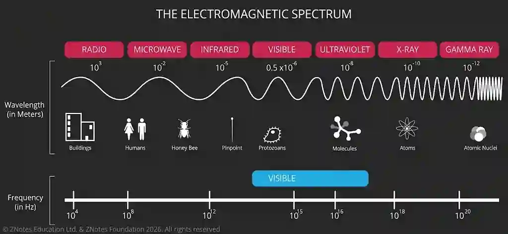

## Electromagnetic spectrum

* The electromagnetic spectrum contains transverse waves

* They can travel in a vacuum without any medium unlike mechanical waves

* All the waves travel in speed $c$ at $3.0$ x $10^8$ $ms^{-1}$

* The only light that the human eye can see is the visible light that has a wavelength

#|
||

Waves

|

Wavelength(m)

|

Uses

||
||

Radio waves

|

$>$ $0.1$

|

broadcasting, Wi-Fi, and radar

||
||

Microwaves

|

$0.1$ to $1 × 10^{-3}$

|

cooking and satellite communication

||
||

Infrared

|

1 × $10^{-3}$ to 7 × $10^{-7}$

|

used in remote controls and thermal imaging

||
||

Visible Light

|

7 × $10^{-7}$ to 4 × $10^{-7}$

|

Photography and optics

||
||

Ultraviolet

|

4 × $10^{-7}$ to 1 × $10^{-8}$

|

Sterilisation and security

||
||

X-ray

|

1 × $10^{-8}$ to 4 × $10^{-13}$

|

medical imaging

||
||

Gamma rays

|

4 × $10^{-13}$ to $10^{-16}$

|

cancer treatment

||
|#

* In visible light spectrum , light having different wavelength has different colours

* Waves with longer wavelength lean towards red while shorter wavelength lean towards violet