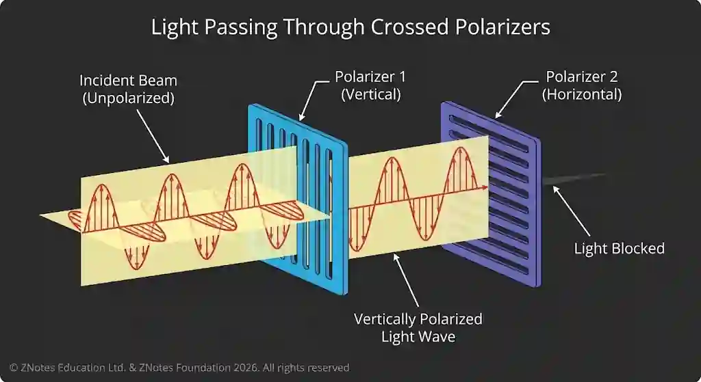

## Polarisation

Polarisation is the phenomena where oscillations of a transverse wave is restricted to a particular direction

* It can only be done to transverse waves

* it can be polarised using a polariser

### Malus’ Law

Intensity of a transverse wave reduces once it passes through a polariser

* $I = I_0 \text{cos}^2\theta$

* $A=A_0 \text{cos}\theta$,  $I \propto A^2$

  * I - resultant intensity

  * $I_0$ - original intensity

  * $\theta$ - angle between the transmission axis of the polaroid and the plane of the incident polarized wave.

  * A - resultant amplitude

  * $A_0$ - original amplitude

**Worked example**

Q - A plane-polarised wave has an initial intensity of 80$Wm^{-2}$. It passes through a polarising filter at an angle of $(60\circ)$

a)Calculate the intensity after the filter.

b)Find the amplitude after the filter

Ans :

a) $I=I_0\cos^2\theta$

$I=80\cos^2(60^\circ)$

$=80(0.5)^2$

$=80(0.25)$

$\boxed{I=20.00\mathrm{Wm^{-2}}}$

b) $I\propto A^2$

$\frac{I}{I_0}=\frac{A^2}{A_0^2}$

$\frac{A}{A_0} =\sqrt{\frac{20}{80}}$

$=\sqrt{\frac14}$

$=\frac12$

$\boxed{A=\frac{A_0}{2}}$