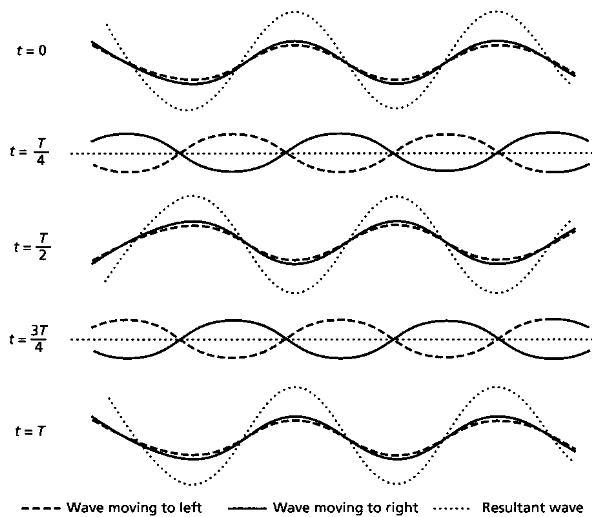

# Superposition

## Stationary Waves

### Principle of Superposition

When two or more waves meet/overlap at a point resultant displacement is sum of the individual displacements.

### Experiments demonstrating stationary waves and finding wavlength

Stationary wave - a wave that doesn’t travel through the medium

**1. Microwaves**

* A **microwave transmitter** sends microwaves towards a **metal reflector**.

* The reflected waves travel back and superpose with the incident waves.

* This produces a **stationary-wave pattern** with **nodes** and **antinodes**.

* A microwave detector is moved along the wave and detects alternating **maximum and minimum intensity**.

* **Maximum intensity → antinode**

* **Minimum intensity → node**

* The distance between two successive nodes or two successive antinodes is:

$\frac{\lambda}{2}$

Therefore:

$\boxed{\lambda=2d}$

where $d$ is the measured distance between successive nodes or antinodes.

**2. Stretched String**

* A string is stretched under **tension** and connected to a **vibrator**.

* The vibrator sends waves along the string.

* The waves reflect from the end and travel back in the opposite direction.

* The incident and reflected waves superpose to form a **stationary wave**.

* **Nodes** are points that remain stationary.

* **Antinodes** are points that vibrate with maximum amplitude.

* The distance between successive nodes or successive antinodes is:

$\boxed{\frac{\lambda}{2}}$

* If the string length $L$ contains $n$ half-wavelengths:

$L=n\frac{\lambda}{2}$

so:

$\boxed{\lambda=\frac{2L}{n}}$

**3. Air Columns**

* A sound source produces waves in an **air column inside a tube**.

* The waves reflect from the end of the tube.

* The incident and reflected waves superpose to form a **stationary wave**.

**Resonance**

**Resonance** occurs when the frequency of the source equals a **natural frequency of the air column**.

At resonance:

* The air column vibrates with **large amplitude**.

* A **loud sound** is produced.

* The air column forms a stationary-wave pattern.

### Open pipe

* An **antinode** occurs at each open end.

* For the fundamental mode:

$\boxed{L=\frac{\lambda}{2}}$

Therefore:

$\boxed{\lambda=2L}$

### Closed pipe

* A **node** occurs at the closed end.

* An **antinode** occurs at the open end.

* For the fundamental mode:

$\boxed{L=\frac{\lambda}{4}}$

Therefore:

$\boxed{\lambda=4L}$

For successive resonances in an air column:

$\boxed{L_2-L_1=\frac{\lambda}{2}}$

so:

$\boxed{\lambda=2(L_2-L_1)}$

**Finding wavelength**

* **Node → next node** =$\frac{\lambda}{2}$

* **Antinode → next antinode** =$\frac{\lambda}{2}$

* **Node → nearest antinode** =$\frac{\lambda}{4}$

* **Successive resonance lengths** differ by $\frac{\lambda}{2}$

$\boxed{v=f\lambda}$

where $v$ is wave speed, $f$ is frequency and $\lambda$ is wavelength.

### Formation of stationary wave on a string

* Wave travels & it reflects at fixed point

* The incident and reflected waves superpose

* The waves superpose so that the resultant amplitude is maximum at an antinode (open end, region of constructive superposition where waves meet in phase)

* The waves superpose so that the resultant amplitude is minimum / zero at a node (closed end, destructive superposition where waves always meet out of phase by π)

### Conditions for formation of stationary waves

* Overlapping waves should have same amplitude & frequency

* The superimposing waves should travel in opposite directions

### Progressive waves & Stationary waves

#|
||

Quantity

|

Progressive wave

|

Stationary wave

||
||

Speed

|

v

|

0

||
||

Wavelength

|

$\lambda$

|

$\lambda$

||
||

Frequency

|

f

|

f

||
||

Energy

|

Transmits energy

|

stores energy (can’t transfer energy)

||
||

Amplitude

|

constant along wave’s length

|

Amplitude increases from node to antinode

||
||

Presence of nodes & antinodes

|

absent

|

present

||
||

Phase change

|

Phase change of *π* at node

|

No phase change

||
|#

### **Stationary wave at different times**

### Kundt’s Tube, Resonance & Air-Column Harmonics

### 1. Kundt’s Tube Experiment

* **Kundt’s tube** is used to demonstrate **longitudinal stationary waves** in air and determine the **wavelength of sound**.

* A sound source produces vibrations in the air column inside the tube.

* Fine powder (e.g. lycopodium powder) is placed inside the tube.

* At resonance, the powder collects at **nodes**, forming regularly spaced heaps.

* The distance between two adjacent heaps corresponds to the distance between adjacent nodes:

distance between adjacent nodes=$\boxed{\text{distance between adjacent nodes}=\frac{\lambda}{2}}$

Therefore,

$\boxed{\lambda=2d}$

where d is the distance between adjacent powder heaps.

The speed of sound is then:

$\boxed{v=f\lambda}$

### 2. Resonance

At resonance:

* The amplitude of vibration becomes **large**.

* A **stationary-wave pattern** is established.

* For an air column, the air vibrates strongly at particular frequencies called its **resonant frequencies**.

**Key idea:**

$\boxed{f_{\text{driving}}\approx f_{\text{natural}}}$

→ resonance → **maximum amplitude**

### 3. Air-Column Harmonics

An air column can support only certain standing-wave patterns because of its boundary conditions.

**Open pipe — both ends open**

Both ends are **displacement antinodes**.

Allowed frequencies:

$\boxed{f_n=\frac{nv}{2L}} \qquad n=1,2,3,\ldots$

**Closed pipe — one end closed**

The **closed end is a displacement node** and the **open end is a displacement antinode**.

Only **odd harmonics** occur :

$\boxed{f_n=\frac{nv}{4L}} \qquad n=1,3,5,\ldots$

**Important:** A closed pipe does **not** produce the 2nd, 4th, 6th, etc. harmonics.