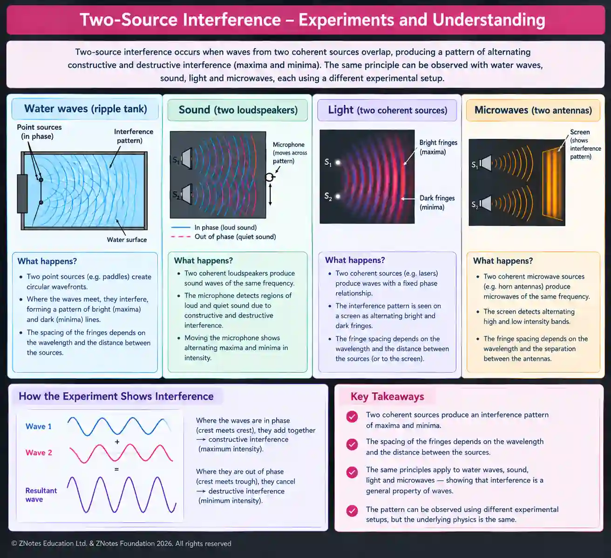

## Interference

**Coherence** - coherent waves are same type of waves that have same frequency/wavelength & constant phase difference

### Interference & Types of interference

Interference - the superposition of two or more waves in similar or same direction to give a resultant wave whose amplitude is given by the principle of superposition.

#|
||

Properties

|

Constructive Interference

|

Destructive Interference

||
||

Occurence

|

Occurs when 2 waves are in phase & have same frequency and amplitude(crest & crest overlap or trough & trough overlap).

|

Occurs when 2 waves are in anti-phase/not in phase (crest & trough overlap) and have same frequency

||
||

Path difference

|

$n$$\lambda$

|

${n\frac{\lambda}{2}}$

||
||

Phase difference

|

0°, 360° (degrees) or 0, 2π (radians)

|

Odd multiples of π (180°, 540°…)

||
|#

### Phase difference

Formula - $\boxed{\Delta\phi=\frac{2\pi\Delta x}{\lambda}}$

Δϕ - phase difference (rad)

λ - wavelength (m)

x - path difference ( m )

### Conditions for observing two-source interference fringes

* Meet at a point

* Must be of the same type

* Must be coherent

* Must be unpolarized or have the same plane of polarization

* Must have approximately the same amplitude

### Experiment regarding interference

### Double-slit interference

In a double-slit experiment, **coherent light** passes through two narrow slits separated by a distance aa. The two slits act as coherent sources and produce an

interference pattern of **bright and dark fringes** on a screen.

The screen is a distance $D$ from the slits.

For small angles:

$$
\boxed{\lambda = \frac{ax}{D}}
$$

where $x$ and $a$ separation between two slits is the distance from the central maximum to the required bright fringe.

### Experimental setup

Main components

* Monochromatic light source, e.g. a laser

* Two narrow slits

* Slit separation $a$

* Screen

* Distance between slits and screen $D$

* Interference pattern containing bright and dark fringes

The central bright fringe is the **central maximum**.

The fringes occur symmetrically on either side of the central maximum.

For $n=0$ $x_{0} = 0$

So the central maximum is at the center of the pattern.

Fringe spacing - $Δx= \frac{\lambda(D)}{a}$

#|
||

Factor

|

Change

|

Effect on fringe spacing

|

Relationship

||
||

Wavelength

|

Increases

|

increases

|

$\lambda \propto Δx$

||
||

Screen Distance

|

Increases

|

increases

|

$D \propto Δx$

||
||

Slit separation

|

Increases

|

decreases

|

$Δx \propto \frac{1}{a}$

||
|#

the following do **not directly determine the fringe spacing**:

* Brightness/intensity of the light

* Number of fringes observed

* Screen brightness

* Light-source power

However, intensity affects **how clearly the fringes can be seen**, not their spacing.

### Worked example

A double-slit experiment uses red light of wavelength 650 nm. The slit separation is 0.30 mm, and the screen is 2.0 m away. Find the distance from the central maximum to the **third bright fringe**

$\lambda = 650 \mathrm{nm} = 6.50\times10^{-7} \mathrm{m}$

$a = 0.30\mathrm{mm} = 3.0\times10^{-4}\mathrm{m}$

$D = 2.0\mathrm{m} \qquad n=3$

$x_n=\frac{n\lambda D}{a}$

$x_3 =\frac{3(6.50\times10^{-7})(2.0)} {3.0\times10^{-4}}$

$x_3=1.3\times10^{-2},\mathrm{m}$

$\boxed{x_3=1.3,\mathrm{cm}}$

### Formation of Bright & Dark fringes

* light diffracts/spreads (at slit(s))

* light (from each slit) superposes/interferes (at screen)

* when phase difference is 0/path difference is n$\lambda$ (where n is an integer) a bright fringe is formed

* when phase difference is 180°/path difference is (n \+ 1)$\lambda$/2 (where n is an integer) a dark fringe is formed