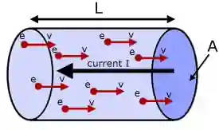
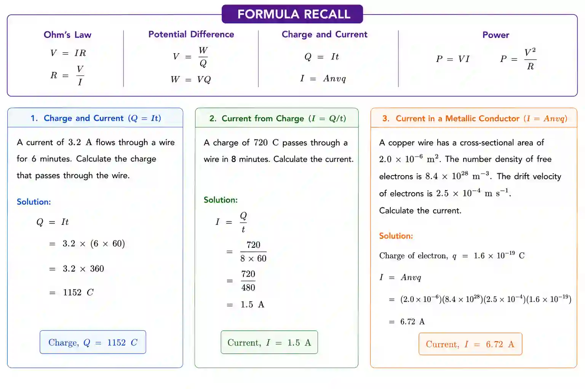

# Electricity

## Electric Current

### Current

Flow of charge carriers

* In a simpler way it’s the number of charged particles passing a point per unit time

* From this we can get the formula : $I=\frac{Q}{t}$

* Q = Charge, I = Current, t = time taken to flow through point

* SI unit : $A$ (1 A = 1 C/s)

* **Conventional current** - flows from the positive to the negative terminal of a source.

* **Electron flow** is opposite - from the negative to the positive terminal.

### Charge

According to the syllabus charge is quantised which basically means that charge can be multiples of whole numbers of e

* as there’s no decimal number of particles the multiple must be an integer

* Charge is discrete

* $Q=nq$

* $Q$ - total charge ( unit - $C$ )

* $n$ - number of particles

* $q$ - charge of one particle ( $q$: $1.6\times10^{-19}\text{C}$ )

The $I=\frac{Q}{t}$ can be rearranged to form $Q=It$

### Current Carrying Conductor

* Electrons move in a certain direction when potential difference is applied across a conductor causing current

* So in any conductor there are lots of electrons there

* The number of conduction electrons per unit volume is called the number density

* Number of electron = number density x volume

* Total charge = number density x volume x $q$ $\rightarrow$ $nALq$

* So $I=\frac{Q}{t}$ and $t=\frac{L}{v}$ & $Q = nALq$ so equation is $I = \frac{\text{nLAq}}{\frac{L}{v}}$​

  $I = Anvq$

  Where

  *L* = length of conductor

  *Q =* total charge

  *A* = cross-sectional area of conductor

  *n* = number density (no. free electrons per unit volume)

  *q* = charge on 1 electron

  *v* = average electron drift velocity

### Example Problem

